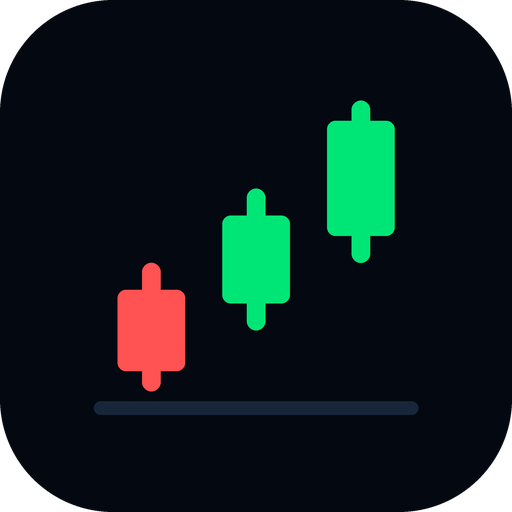

<div align="center">



# ScalpAI

<p>
  
  
  
  
  
  
</p>

An intraday market dashboard and research engine for NIFTY, SENSEX, and BANK NIFTY.
Built to measure whether a scalping idea actually survives costs, data quality, and real market behavior.

<p>
  <a href="#quick-start"><b>Quick Start</b></a> &nbsp;·&nbsp;
  <a href="#what-it-measures"><b>Results</b></a> &nbsp;·&nbsp;
  <a href="engine/README.md"><b>Engine Docs</b></a> &nbsp;·&nbsp;
  <a href="docs/assistant.md"><b>Assistant</b></a> &nbsp;·&nbsp;
  <a href="ALGO-PLAN.md"><b>Plan</b></a>
</p>

</div>

## Overview

ScalpAI has two parts:

- **The dashboard** (`app/`) is a Next.js PWA. It runs on its own with free
  Yahoo data. It shows live scalp and swing calls for NIFTY and SENSEX, tracks
  gold and silver, keeps your stock holdings, and logs every NIFTY signal so its
  hit rate can be checked.
- **The engine** (`engine/`) is Python. It keeps a local SQLite archive of
  Fyers minute bars back to 2017. It replays the dashboard's exact strategy
  against that archive, with parity tests against the JavaScript, prices the
  trades with realistic costs, trains a LightGBM filter, and paper-trades the
  result live.

The question it exists to answer is whether a scalping signal survives costs.
So far the answer is no: the signal is real, but the edge is smaller than the
friction. See [what it measures](#what-it-measures).

## What it measures

The headline backtest replays the v1 NIFTY 5-minute strategy over the full
archive and grades every signal against the bars *after* the bar it was decided
on:

| | NIFTY 5m, 19 Jul 2017 – 6 Aug 2026 (168,708 bars) |
| --- | --- |
| Signals resolved | 1,342 (40% hit target) |
| Average win / loss | +77.3 / −46.7 index points |
| Profit factor, before costs | **1.08** |
| Net per trade, after a 6-point round trip | **−3.63 points** |
| Max drawdown | 5,921 points |

Measured 20 Nov 2026 with `engine.cli backtest --symbol NIFTY --interval 5m`.

A profit factor above 1 before costs means the signal has some edge. Once a
realistic round-trip cost is subtracted, the net figure is what is left of it.
The [engine README](engine/README.md#backtesting) covers costs, regimes, the
learned filter and the option re-pricing in detail.

> **Note.** The engine README's figures were measured before a look-ahead fix
> in `engine/backtest/replay.py`: the replay could resolve a trade on the very
> bar that produced it. Fixing it moved this headline from a profit factor of
> 1.21 to 1.08. Treat the other figures there as optimistic until they are re-run.

## Quick start

### Dashboard

```bash
npm install
npm run dev            # http://localhost:3000
```

No keys are needed. Without network access to Yahoo the header shows **DEMO**
and prices are simulated. Simulated data is never logged.

### Engine

```bash
python3 -m venv .venv
.venv/bin/pip install -r engine/requirements.txt

.venv/bin/python -m engine.cli status          # market hours, holiday calendar
.venv/bin/python -m engine.cli probe           # which data providers answer
.venv/bin/python -m engine.cli sync            # archive the latest bars
.venv/bin/python -m engine.cli backtest --show 20
```

For Fyers data (minute bars back to 2017, option chains), see
[Fyers setup](engine/README.md#fyers-setup). The token expires every night.

### Daily routine

`./start.sh` wraps the scripts in `scripts/`:

| Command | What it does |
| --- | --- |
| `./start.sh morning` | Token check, sync, then paper trading. Start any time before 09:15; it waits for the open. |
| `./start.sh morning --check` | The same checks, without starting the trading loop |
| `./start.sh fyers` | Refresh the Fyers token |
| `./start.sh status` | Market hours, token and archive inventory |
| `./start.sh dashboard` | Dashboard in the background (`stop` / `logs` to manage it) |

### Tests

```bash
npm test                                      # dashboard-only logic
.venv/bin/python -m pytest engine/tests -q    # engine, incl. JS/Python parity
```

## Configuration

Copy `.env.example` to `.env.local`. Every key is optional.

| Variable | Enables |
| --- | --- |
| `GEMINI_API_KEY`, `GROQ_API_KEY` | The deployment's own AI keys. These are used only when `SCALPAI_SHARED_KEYS=1`. Otherwise each visitor adds their own key in Settings → Assistant ([why](docs/assistant.md#your-key-not-the-deployments)). |
| `ENGINE_URL` | Charts and quotes from the engine's archive instead of Yahoo, plus the engine's verdict on the scalp cards |
| `UPSTASH_REDIS_REST_URL`, `UPSTASH_REDIS_REST_TOKEN` | A shared NIFTY signal log and the background alerts switch |
| `ADMIN_TOKEN` | Lets your device change shared state (the alerts switch, syncing and clearing the log). Enter the same value in Settings → Background alerts. Without it, those writes are refused outside local development. |
| `CRON_SECRET` | Protects `/api/nifty-log/cron` |
| `TELEGRAM_BOT_TOKEN`, `TELEGRAM_CHAT_ID` | Phone alerts |
| `FYERS_CLIENT_ID`, `FYERS_SECRET_KEY`, `FYERS_REDIRECT_URI` | Engine data from Fyers |

## Phone alerts

The server can watch NIFTY while the app is closed. On each new signal it logs
the signal and sends a Telegram message.

1. **Storage.** Create a free Upstash Redis database and set
   `UPSTASH_REDIS_REST_URL` and `UPSTASH_REDIS_REST_TOKEN`.
2. **Telegram.** Message @BotFather, send `/newbot`, and set
   `TELEGRAM_BOT_TOKEN`. Send your bot a message, then read `chat.id` from
   `https://api.telegram.org/bot<TOKEN>/getUpdates` and set `TELEGRAM_CHAT_ID`.
   Separate several IDs with commas.
3. **Secrets.** Set `CRON_SECRET` and `ADMIN_TOKEN` to long random strings
   (`openssl rand -hex 24`). Enter `ADMIN_TOKEN` once in Settings → Background
   alerts on your own device.
4. **Schedule.** Vercel Hobby only allows daily crons, so use an external
   scheduler such as cron-job.org. Call this every 2 minutes:

   ```
   GET https://<your-deployment>/api/nifty-log/cron
   Authorization: Bearer <CRON_SECRET>
   ```

   On Vercel Pro you can merge `vercel.cron.pro.example.json` into
   `vercel.json` instead. The tick does nothing outside market hours and on
   NSE holidays.
5. **Verify once** by opening the same URL with `?test=1` appended. Test mode
   ignores market hours, so it is rate-limited to one message every 15
   minutes. Don't leave `?test=1` in a scheduler.

The switch in Settings silences Telegram only. Signals are still logged and
graded while it is off. If the switch can't be read, no message is sent.

## On your phone

The dashboard installs as a PWA over HTTPS. In Chrome, use *Install app*. On
iPhone, use *Share → Add to Home Screen*. Plain HTTP on a LAN address can't
install, because browsers require a secure origin for service workers.

## Assistant

There are three AI features: **Ask EA** reviews one signal card, **the chat**
answers questions about your holdings and can edit them, and **the news brief**
summarises the day's market news. [docs/assistant.md](docs/assistant.md) covers
exactly what each one sends and the commands the chat may run.

## Project layout

```text
app/          Next.js dashboard (App Router) and API routes
app/lib/      Indicators, signals and strategy, mirrored in engine/core
engine/       Data adapters, archive, backtests, research, ML, paper trading
docs/         Assistant documentation
public/       PWA manifest, icons, service worker
scripts/      The commands behind ./start.sh
tests/        Dashboard tests for logic with no Python mirror
```

| Further reading | |
| --- | --- |
| [Engine README](engine/README.md) | Data providers, archive, every backtest and what it found |
| [Assistant](docs/assistant.md) | AI providers, what is sent, chat commands |
| [ALGO-PLAN.md](ALGO-PLAN.md) | Roadmap |

## Troubleshooting

| Symptom | Cause and fix |
| --- | --- |
| Header shows **DEMO** | `/api/market` couldn't reach Yahoo (or the engine). Open `/api/market?symbol=^NSEI` to see the error. |
| VWAP panel says no volume | Yahoo index bars carry no volume. Set `ENGINE_URL` to use Fyers bars. |
| Engine chart is stale | The Fyers token expired overnight. Run `./start.sh fyers`. The dashboard falls back to Yahoo meanwhile. |
| Alerts switch won't move, or Settings says the token was refused | `ADMIN_TOKEN` is unset on the server, or differs from the one saved in Settings |
| "Needs Upstash Redis" | The `UPSTASH_*` variables are missing on the deployment |
| Assistant says "add your own key" | Add a key in Settings → Assistant, or set `SCALPAI_SHARED_KEYS=1` on a private deployment |
| `paper` warns there is no holiday calendar | Add the new year's NSE holidays to `engine/data/timeutil.py` and `app/lib/marketHours.js`. NSE publishes them each December. |
| No "Install app" option on the phone | Serve over HTTPS |

## License

There is no license file in the repository yet.

That means the default copyright applies unless a license is added. If this project is intended to be shared or reused publicly, it is worth adding one explicitly.

---

<div align="center">
  <sub>Built for research, measurement, and disciplined market testing.</sub>
</div>
